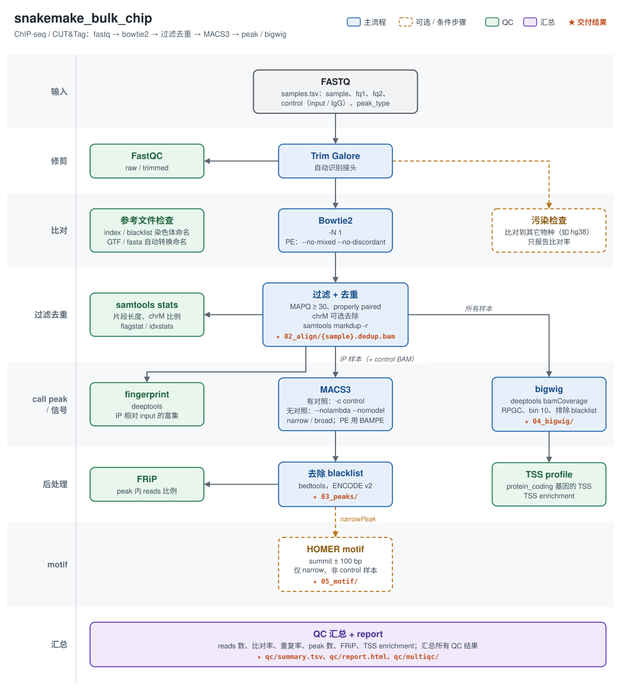

# snakemake_bulk_chip

**中文** | [English](README.en.md)

ChIP-seq（以及 CUT&Tag 等类似数据）本地分析流程（Snakemake ≥ 9.12）。
ATAC-seq 请用 `pipeline/snakemake_bulk_atac`。



<sub>实线框为主流程，虚线框为可选或按样本条件执行的步骤，绿色为 QC，★ 为交付结果（路径相对 `results/`）。PNG 版本：`docs/images/bulk_chip_workflow.png`。</sub>

<details>
<summary>文字版流程</summary>

```
fastq ─► trim_galore ─► bowtie2 ─► 过滤（MAPQ≥30、properly paired、chrM）─► 去重 ─► macs3 ─► 去除 blacklist ─► FRiP
             └─ FastQC (raw / trimmed)                                       ├─► bigwig ─► TSS profile / enrichment
                                                                             ├─► fingerprint、samtools stats（片段长度）
                                                                             └─► HOMER motif（可选）
                                     可选：污染检查（比对到其它物种）
                                     重复一致性（IP 样本）：组内 peak 重现性、consensus peak 相关性与 PCA；性别（chrX / chrY reads 占比，含对照）
                                     汇总：summary.tsv + QC 报告 + MultiQC
```

</details>

---

## 快速开始

```bash
P=/home/LAB/lab_ab_1/pipeline/snakemake_bulk_chip
cd /path/to/project

# 1. 生成项目配置模板（-c 指定的文件不存在时自动生成），修改其中的 genome 等
bash $P/run.sh -c config.yaml

# 2. 扫描 fastq 目录，生成 <outdir>/samples.tsv，并预览任务
bash $P/run.sh -c config.yaml -i /path/to/rawdata -o chipseq_out -n

# 3. 检查 chipseq_out/samples.tsv 后，后台运行
nohup bash $P/run.sh -c config.yaml -o chipseq_out -j 48 -y > run.log 2>&1 &
```

在 samples.tsv 中填写 control / peak_type，并检查 group。

- 不需要激活任何环境，`run.sh` 直接调用 `~/.conda/envs/omics` 中的 snakemake（可用 `SMK_ENV=<环境路径>` 指定其它环境）；macs3 和 deeptools 也使用 `omics` 环境；
  重复一致性的图用 `in202506` 中的 R（ggplot2）绘制。
- 流程代码只有一份，所有项目共用；**每个项目用 `-c` 指定自己的配置文件（必填）**。
  流程先读默认配置 `config/config.yaml`，再用 `-c` 的文件覆盖（嵌套的键逐层合并），所以项目配置可以只写与默认不同的参数。
  每次运行实际使用的（合并后的）配置会存档到 `<outdir>/logs/run_<时间>/config.yaml`。
  默认配置是所有项目的基础，一般不要改它；改了会影响所有项目的续跑。
- 结果、日志都写在 `-o` 指定的目录，多个项目可以同时跑。
- 中断或出错后，**重新运行同一条命令即可断点续跑**。

`run.sh` 的参数与 RNA 流程相同：`-c` 项目配置（必填，不存在时生成模板）、`-i` fastq 目录、`-o` 输出目录（默认 `./chipseq_out`）、`-s` 已有样本表、`-j` 核数、`-n` 预览、`-y` 直接运行、`--` 之后的参数原样传给 snakemake。

---

## 输入：samples.tsv

```
sample        fq1                      fq2                      group     control     peak_type
H3K4me3_rep1  /data/K4_rep1_1.fq.gz    /data/K4_rep1_2.fq.gz    H3K4me3   input_rep1
H3K4me3_rep2  /data/K4_rep2_1.fq.gz    /data/K4_rep2_2.fq.gz    H3K4me3   input_rep2
H3K27me3_rep1 /data/K27_rep1_1.fq.gz   /data/K27_rep1_2.fq.gz   H3K27me3  input_rep1  broad
input_rep1    /data/input_rep1_1.fq.gz /data/input_rep1_2.fq.gz input
input_rep2    /data/input_rep2_1.fq.gz /data/input_rep2_2.fq.gz input
```

| 列 | 说明 |
|---|---|
| `fq2` | 为空即单端。识别 `_1/_2`、`_R1/_R2`、`_R1_001/_R2_001` |
| `control` | ChIP 的 input / IgG 对照，填写**样本表中另一个样本的名字**。<br>被引用为 control 的样本只做比对、QC 和 bigwig，不单独 call peak。<br>留空则不用对照（使用旧版的 `--nolambda` 参数）。 |
| `peak_type` | `narrow` 或 `broad`，留空则使用 config 中的 `peak_type`（默认 narrow）。同一 group 的 IP 样本须一致 |
| `group` | 可选，重复所属的组，用于重复一致性分析；没有该列或为空时按样本名去掉末尾的 `_repN` 推断（`run.sh -i` 生成时已自动填好，可修改）。<br>只比较 IP 样本；control 样本的 group 只用于性别检查 |
| `merge` | 可选，该重复是否参与组 bigwig 的合并：留空或 `yes` 参与，`no` 不参与（如重复一致性 QC 发现有问题的重复）。只影响组 bigwig，不影响 reproducible / consensus peak 和重复一致性分析 |

---

## 主要参数

| 步骤 | 设置 |
|---|---|
| trim | trim_galore（自动识别接头） |
| bowtie2 | `-N 1`；PE 加 `--no-mixed --no-discordant` |
| 线粒体 | 默认保留（`filter.remove_mito: true` 时去除），summary 中报告 `mito_rate (chrM) (% of mapped)` |
| macs3 | 有对照：`-c control --keep-dup all`<br>无对照：`--nomodel --nolambda --extsize 200 --min-length 100`<br>broad：`--broad --broad-cutoff 0.1`；PE 用 `-f BAMPE` |
| QC | FRiP、fingerprint、TSS profile / enrichment、meta gene profile（TSS 到 TES）、片段长度分布 |
| 重复一致性 | 只比较 IP 样本。组内重复两两 peak 的 Jaccard，及各重复组合独有碱基数的 Venn 图（bedtools multiinter，2–4 个重复的组）；组间同样用各组 reproducible peak 画 Venn 图（`replicates.group_venn` 指定比较哪些组）；用 DiffBind 求各组组内 consensus（在 ≥ 2 个重复中出现的 reproducible peak），各组取并集为 consensus peak，`dba.count` 计数 IP（不扣除 input；narrow 取峰顶 ± 200 bp，有 broad 的组时保留原宽度）后以 log2(CPM + 1) 计算相关性（热图与散点矩阵）、层次聚类和 PCA；按 chrX、chrY reads 占全部比对 reads 的比例推断所有样本（含对照）的性别（以 chrY 计数区判定，chrX 只在组内比较） |

其它设置：
- 过滤条件为 MAPQ ≥ 30，并去掉 secondary、supplementary、unmapped reads；PE 只保留两端都合格的 properly paired；
- 用 `samtools markdup -r` 删除 PCR 重复；
- peak 去除 ENCODE blacklist 区域；
- bigwig 默认 RPGC 归一化、bin 10bp，并排除 blacklist 区域。

---

## 配置 config.yaml 要点

| 配置项 | 说明 |
|---|---|
| `genome` | `mm10` / `hg38`；每个物种有 `bowtie2_index`、`fasta`（HOMER 用）、`gtf`（取 protein_coding 基因的 TSS 与基因区间）、`blacklist`、`effective_genome_size` |
| `contamination` | 污染检查：`enabled: true`，`genome` 默认 `hg38`。**本机目前没有人的 bowtie2 index**，打开前需先构建并填入 `references.hg38.bowtie2_index` |
| `filter.mapq` | 默认 30 |
| `filter.remove_mito` | 默认 false |
| `macs3.qvalue` | 默认 0.01 |
| `bigwig.normalize` | `RPGC`（默认）/ `CPM` / `RPKM` / `BPM` / `None`；`bigwig.binsize` 默认 10 |
| `replicates.group_venn` | 组间 Venn 图比较哪些组：每项为 2–4 个组，如 `[[CBP_KA, CBP_NE, CBP_Saline], [p300_KA, p300_NE, p300_Saline]]`，每项一张小图；留空时共 2–4 个组则全部比较，超过 4 组不画 |
| `bigwig.group` | 每组一个 bigwig（IP 样本的组，对照不合并），默认开启；`method: merge`（默认）合并组内去重后的 BAM 再 `bamCoverage`，`mean` 用 `bigwigAverage` 对各重复的 bigwig 取平均（每个重复权重相同）。只生成去掉 `merge: no` 后仍有 ≥ 2 个重复的组。<br>可以先设 `enabled: false` 只跑单个样本，看过重复一致性后标记 `merge` 列、改为 `true` 再运行，只会新增合并这一步；之后修改 `merge` 列也只重做受影响的组 |
| `motif.enabled` | HOMER，仅对 narrow peak 的非 control 样本；`motif.params` 默认 `"-nomotif"`，只做已知 motif；改为 `""` 同时做 de novo（长度 8/10/12，慢很多） |
| `keep.raw_bam` | 默认 false：只保留过滤去重后的 BAM |
| `replicates` | 重复一致性：`enabled`；`min_reps`（reproducible peak 至少出现的重复数，默认 2）；`summits`（DiffBind 计数时取峰顶 ± 多少 bp，默认 200；有 broad 的组时自动不用）；`method`（`pearson` / `spearman`）；`pca_top`（默认 500）；`sex_check` 与 `y_frac`（默认 `[0.002, 0.01]`：chrY 计数区 reads 占全部比对 reads < 0.002% 判为雌性、> 0.01% 判为雄性） |
| `references.<genome>.y_region` | 性别检查统计的 chrY 区域，即 chrY 去掉 PAR（拟常染色体区，X、Y 上序列相同）：mm10 为 `chrY:1-90000000`（PAR 为 chrY:90745845-91644698，PAR 起点上游雌性也有大量 reads，故多留约 745 kb），hg38 为 PAR1 与 PAR2 之间（`chrY:2781480-56887902`）。该区域仍含与 chrX 同源的扩增序列，雌性样本也有少量 reads，因此按阈值判定 |

参考文件的染色体命名：bowtie2 mm10 index、blacklist 是 UCSC 命名（`chr1`）；fasta / gtf 与 RNA 流程同源
（`/data/genome` 下的 Ensembl release-100，命名为 `1` / `MT`），生成 TSS 和 HOMER 输入时自动互转命名。
流程启动时会自动检查能否对应，结果写在 `results/qc/reference_check.txt`。
blacklist 的来源和下载记录见 `~/reference/blacklist/download.log`。

---

## 输出

```
project/
├── samples.tsv
├── results/
│   ├── qc/report.html                   # ★ QC 报告（单文件）：概览、流程与参数、QC 汇总表、重复一致性、信号 profile；指标说明与参考值见 workflow/report/qc_metrics.yaml
│   ├── qc/summary.tsv                   # 每个样本的 reads 数、比对率、重复率、peak 数、FRiP 等（纯数字）
│   ├── 03_peaks/{sample}.narrowPeak     # ★ 已去除 blacklist 的 peak（broad 样本为 .broadPeak）
│   ├── 03_peaks/macs3/{sample}/         # macs3 原始输出（xls、summits 等）
│   ├── 03_peaks/reproducible/{group}.bed  # 组内至少在 min_reps 个重复中出现的 peak（第 4 列为重复数）
│   ├── 03_peaks/consensus.bed           # 各组 reproducible peak 的并集（DiffBind；narrow 为峰顶 ± summits bp）
│   ├── 04_bigwig/{sample}.bw            # ★
│   ├── 04_bigwig/groups/{group}.bw      # ★ 每组合并后的 bigwig
│   ├── 05_motif/{sample}/               # HOMER（可选）
│   ├── 02_align/{sample}.dedup.bam      # 过滤去重后的 BAM（{sample}.raw.bam 为 bowtie2 原始比对）；stats/ 下为 flagstat、idxstats、markdup、samtools stats
│   ├── 01_trim/reports/                 # trim_galore 报告
│   ├── 00_raw/                          # 原始 fastq 的软链接（统一命名为 {sample}_R1/R2）
│   └── qc/
│       ├── multiqc/multiqc_report.html  # ★ 所有 QC 汇总
│       ├── bowtie2/{sample}.log         # 比对统计
│       ├── reference_check.txt          # index、blacklist、GTF 染色体命名检查
│       ├── replicates/                  # 重复一致性：samples.tsv、groups.tsv、peak_overlap.tsv、peak_venn.tsv、group_venn.tsv、correlation.tsv、log2cpm.tsv、pca.tsv、
│       │                                #   peak_counts.tsv（consensus peak 计数矩阵）、diffbind.rds（DBA 对象，可接着做差异分析）；figures/ 下为 PDF、PNG（300 dpi）、SVG
│       ├── deeptools/                   # fingerprint、tss_profile、metagene_samples / metagene_groups（meta gene profile；PNG、TSV、matrix）
│       └── fastqc_*/  frip/  contamination/
└── logs/
    └── run_<时间>/                    # 每执行一次 snakemake 新建一个；续跑时只含这次实际跑了的任务
        ├── <步骤>/<样本>.log          # 出错时先看这里
        ├── benchmarks.tsv             # 本次所有任务的耗时与内存（一张表）
        ├── snakemake.log              # snakemake 完整输出
        ├── config.yaml、samples.tsv   # 本次使用的配置与样本表
        ├── pipeline.txt               # 流程路径、commit 版本、运行命令
        └── software_versions.tsv      # 各软件的版本与实际路径
```

**summary.tsv 的各列**（reads 按单条 read 计，PE 为 R1 + R2；rate 以进入该步骤的 reads 为分母，单位 %，与 ENCODE 等公开标准口径一致；表头括号内为对应的 config 值与分母；参考值来自 ENCODE ChIP-seq 标准，详见 `results/qc/report.html`）：

| 列 | 含义 | 参考 |
|---|---|---|
| `raw_reads` / `clean_reads` | trim 前 / 进入 bowtie2 的 reads | |
| `mapped_reads` | 比对上的 reads | |
| `filtered_reads (q30)` | MAPQ（`filter.mapq`）、配对过滤后（`filter.remove_mito: true` 时也去掉 chrM） | |
| `dedup_reads` | 去重后，用于 call peak 和 bigwig；PE 除以 2 为 usable fragments | TF / narrow ≥ 20M，broad ≥ 45M fragments |
| `clean_rate (% of raw)` | clean_reads / raw_reads | |
| `mapping_rate (% of clean)` | mapped_reads / clean_reads | 与同批比较 |
| `dedup_rate (% of filtered)` | dedup_reads / filtered_reads | |
| `duplicates_rate (% of filtered)` | (filtered_reads − dedup_reads) / filtered_reads | 与同批比较；CUT&Tag 通常较高 |
| `mito_rate (chrM) (% of mapped)` | 线粒体 reads / mapped_reads（`filter.mito_name`） | 与同批比较 |
| `peaks` / `frip` | peak 数与 FRiP（peak 内 reads / dedup_reads） | TF ChIP 的 FRiP ≥ 1%（ENCODE 指南） |
| `tss_enrichment (±3000bp)` | TSS 中心信号 / 两端背景（按 deeptools profile 估算，窗口由 `qc.tss_matrix` 决定） |  |
| `contamination_rate (% of clean)` | clean reads 比对到污染物种的比例（仅 `contamination.enabled` 时输出） | |

---

## 常用操作

```bash
bash $P/run.sh -c config.yaml -o chipseq_out -y                          # 断点续跑
bash $P/run.sh -c config.yaml -o chipseq_out -y -- --until macs3         # 只跑到 call peak
bash $P/run.sh -c config.yaml -o chipseq_out -y -- --forcerun macs3      # 改了 macs3 参数后强制重跑（及其下游）
bash $P/run.sh -c config.yaml -o chipseq_out -y -- --unlock              # 强行中断后解锁
```

在 samples.tsv 中追加样本后直接运行即可，已完成的样本不会重跑。

---

## 与旧版的主要区别

- 不再提交 PBS，改为本地运行；不再通过 `--config reads=<JSON>` 传参，改用 samples.tsv。
- SE/PE 规则合并，文件名不再带 `_pe` / `_se`。
- ATAC-seq 拆分为独立的 `snakemake_bulk_atac` 流程。
- 新增 input/IgG 对照、broad peak、blacklist 过滤、FRiP、fingerprint、TSS enrichment、片段长度分布、QC 报告，以及可选的污染检查。
- 唯一比对从 `grep -v "XS:i:"`（PE 会留下孤立 mate）改为 MAPQ ≥ 30 加 properly paired 过滤。
- 去重从 sambamba 改为 `samtools markdup`（本机没有 sambamba）；call peak 使用 `omics` 环境中的 macs3。
- HOMER 改为传入基因组 FASTA（本机 HOMER 没有安装基因组），以 summit ± 100bp 做 motif 分析。
- human 比对改为可选的污染检查，默认关闭，并且可以选择其它物种。
- 删除了不属于流程本身的独立脚本（`idr_peak.sh`、`mean.py`、`download_sra.sh` 等）；下载数据请用 `pipeline/utilities/download_sra_iseq.sh`。
